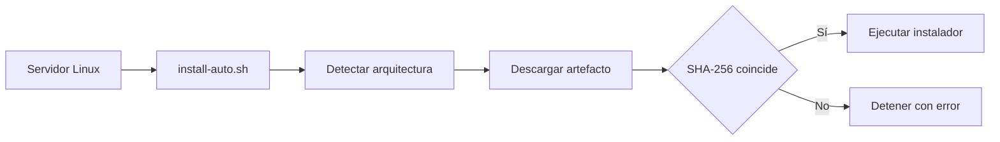

<div align="center">


# MoviVIP Network

### Instalador multi-protocolo para servidores Linux

**Detecta la arquitectura · Verifica el artefacto · Inicia la instalación**

[Instalación](#instalación) ·
[Compatibilidad](#compatibilidad) ·
[Componentes](#componentes) ·
[Integridad](#integridad-y-descargas) ·
[Soporte](#soporte)

<br />

[](https://github.com/studioanime977/MoviVIPNetwork)
[](https://github.com/studioanime977/MoviVIPNetwork)
[](#licencia)
[](https://t.me/MoviVIP)

</div>

---

MoviVIP Network automatiza la instalación de servicios de conectividad y
herramientas de administración en un servidor Linux. El repositorio publica
un instalador para varias arquitecturas y un helper que detecta la arquitectura,
descarga el artefacto correspondiente y comprueba su SHA-256 antes de ejecutarlo.

> **Importante:** el instalador realiza cambios en el sistema. Úsalo únicamente
> en un servidor que administres, con una licencia válida y después de revisar
> los requisitos y el impacto de la instalación.

## Instalación

### Requisitos

- VPS o servidor Linux con Ubuntu 20.04+ o Debian 11+.
- Acceso de `root` y conexión a Internet.
- `curl` y `sha256sum`. El helper instala `curl` si no está disponible.
- Una licencia MoviVIP válida. La disponibilidad de funciones puede depender
  del plan contratado.

### Instalador automático

El helper identifica la arquitectura del sistema y selecciona el artefacto
correspondiente. Descárgalo primero y ejecútalo como `root`:

```bash
apt-get update
apt-get install -y ca-certificates curl
curl -fsSLo install-auto.sh \
  https://raw.githubusercontent.com/studioanime977/MoviVIPNetwork/main/install-auto.sh

# Opcional: revisa el script antes de ejecutarlo.
less install-auto.sh

bash install-auto.sh
```

Introduce la clave de licencia cuando el instalador la solicite. Si prefieres
proporcionarla como argumento, evita hacerlo en terminales compartidas o
comandos que queden guardados en el historial.

### Descarga directa

Para instalaciones manuales, el repositorio publica los binarios en
[`stubs/`](https://github.com/studioanime977/MoviVIPNetwork/tree/main/stubs).
El nombre del artefacto incluye el sistema y la arquitectura, por ejemplo
`setup-linux-amd64`. La instalación automática es la opción recomendada porque
incluye la selección de arquitectura y la comprobación SHA-256.

## Compatibilidad

El helper de publicación incluye estos destinos:

| Arquitectura reportada por Linux | Artefacto |
|---|---|
| `x86_64`, `amd64` | `setup-linux-amd64` |
| `aarch64`, `arm64` | `setup-linux-arm64` |
| `armv7l`, `armhf`, `armv7`, `armv8l` | `setup-linux-armv7` |
| `armv6l` | `setup-linux-armv6` |
| `armv5l` | `setup-linux-armv5` |
| `i386`, `i686` | `setup-linux-386` |
| `loongarch64` | `setup-linux-loong64` |
| `mips` | `setup-linux-mips` |
| `mipsel` | `setup-linux-mipsle` |
| `mips64` | `setup-linux-mips64` |
| `mips64el`, `mips64le` | `setup-linux-mips64le` |
| `ppc64` | `setup-linux-ppc64` |
| `ppc64le` | `setup-linux-ppc64le` |
| `riscv64` | `setup-linux-riscv64` |
| `s390x` | `setup-linux-s390x` |

La tabla refleja los destinos reconocidos por `install-auto.sh`; no implica
que cada protocolo o dependencia de terceros tenga disponibilidad idéntica
en todas las arquitecturas.

## Componentes

El paquete reúne protocolos, túneles y herramientas de administración. La
selección disponible puede variar según la licencia y la arquitectura.

<details>
<summary><strong>Protocolos y servicios incluidos</strong></summary>

- **Acceso y transporte:** OpenSSH, Dropbear, SSL/TLS y WebSocket.
- **VPN y túneles:** XRay/V2Ray, WireGuard, OpenVPN, Hysteria 2, SlowDNS,
  VayDNS, SystemDNS, ZiVPN, DTunnel, HCR Relay, SSH-XHTTP, BHTTP v2 y BTUN.
- **Proxy y utilidades de red:** Shadowsocks, SOCKS5, Squid, BadVPN UDPGW y
  UDP Custom.
- **Administración:** gestor de usuarios, bot de Telegram, 3X-UI, panel web
  MoviVIP y Webmin.

</details>

## Cómo funciona el instalador automático



El helper compara el hash descargado con el valor registrado en el propio
script. Esta verificación detecta diferencias respecto a ese valor; por sí sola
no constituye una auditoría del binario ni una firma criptográfica independiente.

## Integridad y descargas

- Descarga el helper y los artefactos únicamente desde el
  [repositorio oficial](https://github.com/studioanime977/MoviVIPNetwork).
- El helper contiene los SHA-256 esperados para los binarios publicados y
  detiene la instalación si el hash no coincide.
- Revisa el contenido del helper antes de ejecutarlo si necesitas comprobar
  qué acciones realiza.
- No compartas tu licencia ni la incluyas en capturas, scripts públicos o
  comandos que se guarden en el historial.

Los artefactos de `stubs/` son binarios ejecutables. La presencia de un hash
permite comprobar que un archivo coincide con el valor esperado por el helper,
pero no permite inspeccionar su código fuente.

## Actualizaciones

Consulta los anuncios del [canal oficial](https://t.me/MoviVIPNetwork) para
conocer las versiones publicadas. Antes de actualizar un servidor en uso,
respalda su configuración y datos y revisa las notas de la versión.

## Preguntas frecuentes

<details>
<summary><strong>¿Qué hace el instalador automático?</strong></summary>

Detecta la arquitectura del sistema, descarga el artefacto asociado, verifica
su SHA-256 y lo ejecuta. Si la arquitectura no está soportada o la verificación
falla, se detiene.
</details>

<details>
<summary><strong>¿Necesito compilar el proyecto?</strong></summary>

No para instalar desde este repositorio: los artefactos de instalación se
publican en `stubs/`. El helper requiere Bash, `curl` y `sha256sum`.
</details>

<details>
<summary><strong>¿La licencia funciona en más de un servidor?</strong></summary>

La activación y las transferencias dependen de las condiciones de la licencia.
Contacta con el soporte oficial para validar una migración.
</details>

<details>
<summary><strong>¿Puedo usarlo en una distribución o arquitectura que no aparece?</strong></summary>

El helper rechaza arquitecturas que no reconoce. No fuerces la descarga de un
binario de otra arquitectura; consulta con soporte antes de instalar.
</details>

## Soporte

| Canal | Para qué sirve |
|---|---|
| [Soporte MoviVIP](https://t.me/MoviVIP) | Licencias, instalación y asistencia técnica |
| [Canal de anuncios](https://t.me/MoviVIPNetwork) | Publicaciones y novedades |
| [Comunidad](https://t.me/MoviVIPNet) | Consultas entre usuarios |
| [Correo](mailto:vipnetworkmovi@gmail.com) | Consultas generales |
| [Sitio web](https://movivip-network.web.app/) | Información del proyecto |

## Licencia

MoviVIP Network Setup y sus binarios son software propietario. El acceso y uso
requieren autorización y están sujetos a las condiciones de la licencia
correspondiente. Este repositorio no concede una licencia para copiar,
redistribuir o modificar los binarios.

---

<div align="center">

**MoviVIP Network** · VPS · Servers · VPN · Ingeniería de sistemas

[Repositorio](https://github.com/studioanime977/MoviVIPNetwork) ·
[Soporte](https://t.me/MoviVIP) ·
[Anuncios](https://t.me/MoviVIPNetwork)

</div>
