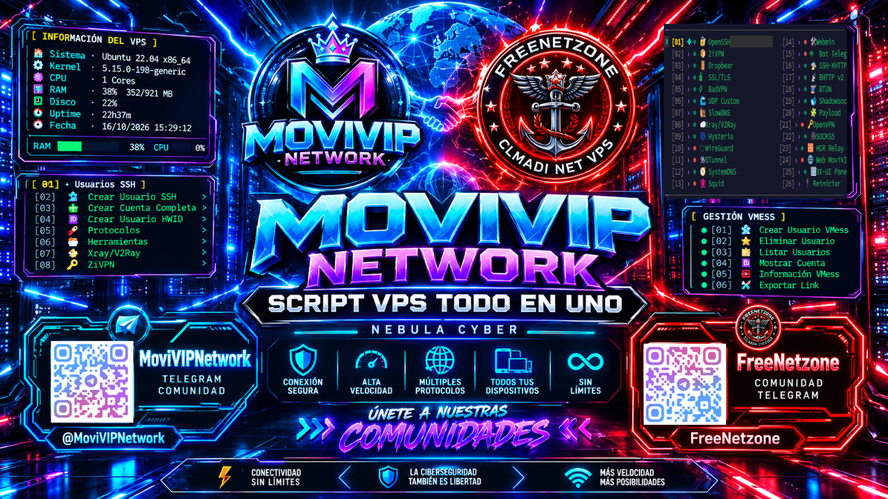
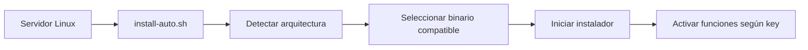

<div align="center">



# MoviVIP Network

### Una plataforma de instalación para servicios de conectividad en Linux

<p>
  <a href="https://github.com/studioanime977/MoviVIPNetwork/stargazers"></a>
  <a href="https://github.com/studioanime977/MoviVIPNetwork/network/members"></a>
  
  
</p>

<p>
  <a href="#instalacion"></a>
  <a href="https://t.me/movivip_key_bot"></a>
  <a href="https://t.me/MoviVIP"></a>
</p>

<p>
  <a href="#espanol">Español</a> ·
  <a href="#english">English</a> ·
  <a href="#compatibilidad">Compatibilidad</a> ·
  <a href="#protocolos-y-conectividad">Protocolos</a> ·
  <a href="#gestion-de-usuarios">Usuarios</a> ·
  <a href="#herramientas-y-administracion-del-servidor">Herramientas</a> ·
  <a href="#socios-autorizados">Socios autorizados</a> ·
  <a href="https://t.me/MoviVIPNetwork">Novedades</a> ·
  <a href="https://www.movivipoppax.uk/">Sitio oficial</a>
</p>

</div>

---

<div align="center">

**Una sola instalación. Herramientas de conectividad, túneles y administración para tu servidor Linux.**

</div>

> [!IMPORTANT]
> MoviVIP configura servicios del sistema y requiere acceso `root`. Úsalo
> únicamente en servidores que administras; conserva acceso a la consola del
> proveedor y respalda tu configuración antes de empezar.

## Español

MoviVIP Network reúne servicios de acceso, VPN, túneles, proxy y herramientas de
administración en un instalador Linux con selección automática de arquitectura.
La disponibilidad de cada función puede depender de la arquitectura, las
dependencias externas y la licencia.

<div align="center">

| 🆓 **Empieza gratis** | ✨ **Desbloquea todo** |
|:---:|:---:|
| Crea tu key gratuita desde el bot oficial de Telegram. | También puedes obtener una key Premium con todas las funciones desbloqueadas. |
| [**Crear key gratis →**](https://t.me/movivip_key_bot) | [**Ver opciones de key →**](https://t.me/movivip_key_bot) |

</div>

## Instalación

### Requisitos

- Ubuntu 18.04+ o Debian 11+.
- Acceso de `root` y conexión a Internet.
- Un servidor Linux compatible.
- Una key MoviVIP para activar las funciones correspondientes.

### Instalar desde el servidor

Conéctate al servidor como `root` y ejecuta el comando:

```bash
apt-get update -y && apt-get install -y curl
curl -fsSL -o /root/install-auto.sh https://raw.githubusercontent.com/studioanime977/MoviVIPNetwork/main/install-auto.sh
chmod +x /root/install-auto.sh
bash /root/install-auto.sh
```

El instalador detecta la arquitectura del servidor y descarga el binario
correspondiente. Para generar una key gratuita o consultar las opciones
Premium, visita [@movivip_key_bot](https://t.me/movivip_key_bot).

### Antes de empezar

- Respalda los datos y la configuración importantes.
- Asegúrate de poder entrar a la consola web o de rescate del proveedor.
- Revisa las reglas de firewall del VPS y del proveedor.
- Abre únicamente los puertos que necesiten los servicios que vas a utilizar.
- Mantén activa tu sesión SSH hasta confirmar que el acceso sigue funcionando.

## Compatibilidad

### Sistemas operativos y arquitecturas

| Sistema operativo | Arquitecturas |
|---|---|
| Ubuntu 18.04, 20.04, 22.04 y 24.04 | `x86_64` / `amd64`, `i386`, `arm64` / `aarch64`, `armv5`, `armv6`, `armv7`, `riscv64`, `loong64`, `s390x`, `mips`, `mipsle`, `mips64`, `mips64le`, `ppc64`, `ppc64le` |
| Debian 11 y 12 | `x86_64` / `amd64`, `i386`, `arm64` / `aarch64`, `armv5`, `armv6`, `armv7`, `riscv64`, `loong64`, `s390x`, `mips`, `mipsle`, `mips64`, `mips64le`, `ppc64`, `ppc64le` |

> ⚠️ **ARMv7 e i386 tienen soporte parcial.** La disponibilidad de algunas
> funciones también depende de la arquitectura y de sus dependencias.

### Nube y virtualización

Oracle Cloud (A1/Flex) · AWS Graviton · Google Cloud · Microsoft Azure ·
DigitalOcean · Vultr · Hetzner · Contabo · **KVM**

## Protocolos y conectividad

El menú de protocolos permite instalar, configurar y revisar el estado de los
servicios disponibles:

| Grupo | Protocolos y servicios |
|---|---|
| Acceso y transporte | OpenSSH, Dropbear, SSL/TLS, WebSocket, SSH-XHTTP, BHTTP v2, Payload |
| XRay / V2Ray | VMess, VLESS, Trojan; administración también disponible mediante 3X-UI |
| VPN | WireGuard, OpenVPN, ZiVPN |
| Túneles | Hysteria, SlowDNS, DTunnel, HCR Relay, BTUN |
| Proxy y UDP | Shadowsocks, SOCKS5, Squid, BadVPN UDPGW, UDP Custom |
| DNS y proxy moderno | SystemDNS; Sing-box con TUIC, AnyTLS y Naive |
| Paneles y servicios | Webmin, panel web MoviVIP, bot de Telegram |

Los servicios se gestionan desde el panel de MoviVIP: instalación,
configuración, consulta de estado y reinicio. La capa SSL/TLS admite entrada
multi-puerto y enruta el tráfico al protocolo de destino correspondiente, sin
exponer aquí los valores de los puertos.

## Gestión de usuarios

El módulo de usuarios reúne las operaciones de cuentas y control de acceso:

- Crear cuentas individuales o completas y seleccionar los servicios asociados.
- Listar, consultar sesiones conectadas, editar, renovar, suspender, eliminar y reactivar cuentas.
- Administrar cuentas con HWID: crear, listar, cambiar, bloquear, limitar y renovar identificadores.
- Migrar HWID a llave SSH y gestionar límites de conexiones, consumo y expiraciones.
- Respaldar cuentas y personalizar el banner SSH.

## Herramientas y administración del servidor

El menú de herramientas centraliza las siguientes tareas:

| Área | Funciones |
|---|---|
| Red y dominios | Gestión de dominios y certificados TLS, Cloudflare DNS, CloudFront CDN, firewall, reglas de acceso y utilidades de puertos |
| Diagnóstico y protección | Auditoría, escáner de host/dominio, detección anti-minero, Fail2ban, seguridad, pruebas de carga, bloqueo de anuncios y torrents |
| Supervisión | Estado e información del VPS, consumo y snapshots de red, monitor en vivo, monitor de cuotas HWID, pruebas de velocidad y CheckUser |
| Operación del sistema | Optimización, reinicio de servicios, reinicio o reinstalación del VPS, inicio automático y gestión de credenciales |
| Archivos y automatización | Archivo Online, FileBrowser, bot de administración, sincronización y notificaciones |
| Gestión comercial | Facturación, identidad visual y envío de facturas, según el módulo activado |

El menú principal también ofrece consulta de licencia, actualización del script
y acceso directo a módulos de usuarios y protocolos. La interfaz incluye
soporte multilingüe para administrar el servidor desde el terminal.

## Flujo de instalación



## Uso responsable

- Descarga el instalador únicamente desde el
  [repositorio oficial](https://github.com/studioanime977/MoviVIPNetwork).
- No compartas tu key en capturas, canales públicos ni scripts compartidos.
- Conserva copias de seguridad y un método alternativo de acceso al servidor.
- Revisa el firewall externo del proveedor además del firewall del sistema.
- Utiliza los servicios solo en sistemas y redes que estés autorizado a administrar.

## Actualizaciones

Consulta el [canal oficial de anuncios](https://t.me/MoviVIPNetwork) para conocer
las versiones disponibles. Antes de actualizar un servidor en uso, revisa los
cambios publicados y respalda la configuración y los datos.

## Solución de problemas

| Situación | Qué revisar |
|---|---|
| `Ejecutar como root` | Ejecuta el instalador desde una sesión administrativa autorizada. |
| `Arquitectura desconocida` | Comprueba `uname -m` y confirma que tu servidor sea compatible. |
| No se puede descargar el instalador | Revisa la conexión a Internet, DNS y acceso al repositorio oficial. |
| No hay conexión al servidor después de instalar | Usa la consola del proveedor y revisa el firewall y las reglas de red. |
| Key no aceptada | Comprueba que la key esté escrita correctamente y contacta con soporte. |

## Preguntas frecuentes

<details>
<summary><strong>¿Dónde consigo una key gratuita?</strong></summary>

Puedes crearla desde el bot oficial [@movivip_key_bot](https://t.me/movivip_key_bot).
</details>

<details>
<summary><strong>¿Hay keys Premium?</strong></summary>

Sí. También puedes obtener una key Premium con todas las funciones desbloqueadas.
Consulta las opciones disponibles desde [el bot oficial](https://t.me/movivip_key_bot).
</details>

<details>
<summary><strong>¿Tengo que compilar el proyecto?</strong></summary>

No para instalar desde el repositorio público: el instalador selecciona el
binario publicado para la arquitectura reconocida.
</details>

<details>
<summary><strong>¿Todos los protocolos funcionan en todas las arquitecturas?</strong></summary>

No necesariamente. La disponibilidad puede variar según la arquitectura, las
dependencias externas y la licencia.
</details>

## Canales oficiales

| Canal | Enlace |
|---|---|
| Keys gratuitas y opciones Premium | [@movivip_key_bot](https://t.me/movivip_key_bot) |
| Licencias e instalación | [@MoviVIP](https://t.me/MoviVIP) |
| Anuncios y versiones | [@MoviVIPNetwork](https://t.me/MoviVIPNetwork) |
| Comunidad | [@MoviVIPNet](https://t.me/MoviVIPNet) |
| Sitio web | [movivipoppax.uk](https://www.movivipoppax.uk/) |
| Correo | [vipnetworkmovi@gmail.com](mailto:vipnetworkmovi@gmail.com) |

## Socios autorizados

<div align="center">

**FreeNetZone**

[Comunidad de Telegram](https://t.me/FreeNetZonevip) ·
[Grupo de Telegram](https://t.me/FreeNetZonevips)

</div>

## Licencia

MoviVIP Network Setup y sus binarios son software propietario. El acceso y uso
están sujetos a las condiciones de la licencia correspondiente. La publicación
de un artefacto en este repositorio no concede permiso para copiarlo,
redistribuirlo, modificarlo o eludir su mecanismo de licencia.

---

<div align="center">

## English

### One Linux installer for connectivity, tunneling, and server administration

</div>

MoviVIP Network brings together access services, VPNs, tunnels, proxies, and
administration tools in a Linux installer with automatic architecture
selection. Feature availability may depend on the architecture, external
dependencies, and license.

<div align="center">

| 🆓 **Start for free** | ✨ **Unlock everything** |
|:---:|:---:|
| Create a free key with the official Telegram bot. | Premium keys are also available with all features unlocked. |
| [**Get a free key →**](https://t.me/movivip_key_bot) | [**Explore key options →**](https://t.me/movivip_key_bot) |

</div>

### Requirements

- Ubuntu 18.04+ or Debian 11+.
- Authorized `root` access and an Internet connection.
- A compatible Linux server.
- A MoviVIP key to activate the applicable features.

### Install on your server

Connect to your server as `root` and run:

```bash
apt-get update -y && apt-get install -y curl
curl -fsSL -o /root/install-auto.sh https://raw.githubusercontent.com/studioanime977/MoviVIPNetwork/main/install-auto.sh
chmod +x /root/install-auto.sh
bash /root/install-auto.sh
```

The installer detects the server architecture and downloads the corresponding
binary. Get a free key or learn about Premium keys at
[@movivip_key_bot](https://t.me/movivip_key_bot).

### Operating systems and architectures

| Operating system | Architectures |
|---|---|
| Ubuntu 18.04, 20.04, 22.04, and 24.04 | `x86_64` / `amd64`, `i386`, `arm64` / `aarch64`, `armv5`, `armv6`, `armv7`, `riscv64`, `loong64`, `s390x`, `mips`, `mipsle`, `mips64`, `mips64le`, `ppc64`, `ppc64le` |
| Debian 11 and 12 | `x86_64` / `amd64`, `i386`, `arm64` / `aarch64`, `armv5`, `armv6`, `armv7`, `riscv64`, `loong64`, `s390x`, `mips`, `mipsle`, `mips64`, `mips64le`, `ppc64`, `ppc64le` |

> ⚠️ **ARMv7 and i386 have partial support.** Some features also depend on
> architecture-specific availability and external dependencies.

**Cloud and virtualization:** Oracle Cloud (A1/Flex), AWS Graviton, Google
Cloud, Microsoft Azure, DigitalOcean, Vultr, Hetzner, Contabo, and **KVM**.

### Protocols and connectivity

The protocol menu lets you install, configure, and check the status of:

| Group | Protocols and services |
|---|---|
| Access and transport | OpenSSH, Dropbear, SSL/TLS, WebSocket, SSH-XHTTP, BHTTP v2, Payload |
| XRay / V2Ray | VMess, VLESS, Trojan; also manageable through 3X-UI |
| VPN | WireGuard, OpenVPN, ZiVPN |
| Tunnels | Hysteria, SlowDNS, DTunnel, HCR Relay, BTUN |
| Proxy and UDP | Shadowsocks, SOCKS5, Squid, BadVPN UDPGW, UDP Custom |
| DNS and modern proxy | SystemDNS; Sing-box with TUIC, AnyTLS, and Naive |
| Panels and services | Webmin, MoviVIP web panel, Telegram bot |

Services are managed from the MoviVIP panel: installation, configuration,
status checks, and restarts. The SSL/TLS layer supports multi-port entry and
routes traffic to the corresponding destination protocol without listing port
values here.

### User management

The user module brings together account and access-control operations:

- Create individual or complete accounts and select their associated services.
- List accounts, view active sessions, edit, renew, suspend, delete, and reactivate users.
- Manage HWID accounts: create, list, change, block, set limits, and renew identifiers.
- Migrate HWID to SSH keys and manage connection, usage, and expiration limits.
- Back up accounts and customize the SSH banner.

### Server tools and administration

The tools menu centralizes these tasks:

| Area | Features |
|---|---|
| Network and domains | Domain and TLS certificate management, Cloudflare DNS, CloudFront CDN, firewall, access rules, and port utilities |
| Diagnostics and protection | Audits, host/domain scanner, anti-miner detection, Fail2ban, security checks, load tests, ad and torrent blocking |
| Monitoring | VPS status and details, network usage and snapshots, live monitor, HWID quota monitor, speed tests, and CheckUser |
| System operations | Optimization, service restarts, VPS reboot or reinstall, auto-start, and credential management |
| Files and automation | Online files, FileBrowser, admin bot, synchronization, and notifications |
| Business tools | Invoicing, visual identity, and invoice delivery, when the module is enabled |

The main menu also provides license status, script updates, and direct access
to user and protocol modules.

### Responsible use

- Download the installer only from the
  [official repository](https://github.com/studioanime977/MoviVIPNetwork).
- Do not share your key in screenshots, public channels, or shared scripts.
- Keep backups and an alternative way to access your server.
- Check both provider-level and system firewalls.
- Use these services only on systems and networks you are authorized to manage.

### Updates and troubleshooting

See the [official announcements channel](https://t.me/MoviVIPNetwork) for
available versions. Back up configuration and data before updating a server
in use.

| Situation | What to check |
|---|---|
| Root access required | Run the installer from an authorized administrative session. |
| Unknown architecture | Check `uname -m` and confirm your server is supported. |
| Installer download fails | Check Internet access, DNS, and connectivity to the official repository. |
| Server access changed | Use the provider console and inspect firewall and network rules. |
| Key rejected | Check the key and contact support to review activation. |

### Official channels

- Free keys and Premium options: [@movivip_key_bot](https://t.me/movivip_key_bot)
- Licensing and installation support: [@MoviVIP](https://t.me/MoviVIP)
- Release announcements: [@MoviVIPNetwork](https://t.me/MoviVIPNetwork)
- Community: [@MoviVIPNet](https://t.me/MoviVIPNet)
- [Website](https://www.movivipoppax.uk/)
- [Email](mailto:vipnetworkmovi@gmail.com)

### Authorized partners

**FreeNetZone:** [Telegram community](https://t.me/FreeNetZonevip) ·
[Telegram group](https://t.me/FreeNetZonevips)

### License

MoviVIP Network Setup and its binaries are proprietary software. Access and use
are subject to the applicable license terms. Publishing an artifact here does
not grant permission to copy, redistribute, modify, or bypass its license
mechanism.

---

<div align="center">

**MoviVIP Network** · Linux servers · Connectivity · Administration

<a href="https://t.me/movivip_key_bot"></a>

<br /><br />

<a href="https://github.com/studioanime977/MoviVIPNetwork"></a>

<br />

**Uso autorizado con una key MoviVIP válida · Todos los derechos reservados**

<br />

<a href="https://github.com/studioanime977/MoviVIPNetwork">GitHub</a> ·
<a href="https://t.me/movivip_key_bot">Get a key</a> ·
<a href="https://t.me/MoviVIP">Support</a> ·
<a href="https://t.me/MoviVIPNetwork">Announcements</a> ·
<a href="https://t.me/FreeNetZonevip">Authorized partner: FreeNetZone</a>

</div>
