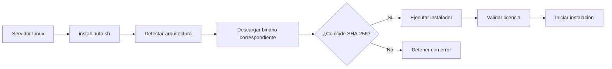

<div align="center">


# MoviVIP Network

### Infraestructura multi-protocolo para servidores Linux

**Un instalador · múltiples arquitecturas · verificación SHA-256**

<br />

<a href="#instalacion">Instalación</a> ·
<a href="#compatibilidad">Compatibilidad</a> ·
<a href="#componentes">Componentes</a> ·
<a href="#como-funciona">Cómo funciona</a> ·
<a href="#english">English</a>

<br /><br />

<a href="https://github.com/studioanime977/MoviVIPNetwork"></a>


<a href="#licencia"></a>

<br />

<a href="https://t.me/MoviVIP"><strong>Soporte</strong></a> ·
<a href="https://t.me/MoviVIPNetwork">Novedades</a> ·
<a href="https://movivip-network.web.app/">Sitio oficial</a>

</div>

---

> [!IMPORTANT]
> Este proyecto instala y configura servicios en un servidor. Úsalo solo en
> equipos que administras, conserva acceso a la consola del proveedor y haz un
> respaldo antes de comenzar. La licencia es necesaria para activar el producto.

## Español

MoviVIP Network reúne servicios de acceso, VPN, túneles, proxy y herramientas de
administración para servidores Linux. El repositorio publica los instaladores
por arquitectura y un helper que selecciona el binario compatible y verifica
su SHA-256 antes de ejecutarlo.

### En un vistazo

| | |
|---|---|
| **Qué encontrarás** | Instalador Linux, servicios de conectividad y utilidades de administración. |
| **Cómo se instala** | Descarga `install-auto.sh`, revisa el script y ejecútalo como `root`. |
| **Cómo se valida la descarga** | El helper compara el binario con el SHA-256 esperado incluido en el propio script. |
| **Qué puede variar** | Funciones según licencia, arquitectura, sistema operativo y disponibilidad de binarios de terceros. |

## Instalación

### Requisitos

- Ubuntu 20.04+ o Debian 11+.
- Acceso de `root` y conexión a Internet.
- Bash, `sha256sum` y `curl` (el helper instala `curl` cuando falta).
- Una licencia MoviVIP válida.

### Antes de instalar

- Guarda una copia de la configuración y los datos importantes.
- Asegúrate de poder entrar a la consola web o de rescate del proveedor.
- Revisa las reglas de firewall del VPS y del proveedor.
- Define qué servicios vas a utilizar y abre únicamente los puertos necesarios
  para ellos.
- No cierres tu sesión SSH actual mientras verificas que el acceso nuevo funciona.

### Instalador automático

Descarga el helper desde el repositorio oficial, revísalo y ejecútalo:

```bash
apt-get update
apt-get install -y ca-certificates curl
curl -fsSLo install-auto.sh \
  https://raw.githubusercontent.com/studioanime977/MoviVIPNetwork/main/install-auto.sh

# Inspecciona el instalador antes de ejecutarlo.
less install-auto.sh
```

Para introducir la licencia sin escribirla en el comando ni guardarla en el
historial de la terminal:

```bash
read -rsp "Licencia MoviVIP: " MV_LICENSE
printf '\n'
bash install-auto.sh "$MV_LICENSE"
unset MV_LICENSE
```

El helper requiere `root`. Si la verificación SHA-256 falla o la arquitectura
no es reconocida, se detiene: no fuerces la instalación con un binario distinto.

### Descarga manual

Los binarios publicados están en [`stubs/`](https://github.com/studioanime977/MoviVIPNetwork/tree/main/stubs).
Sus nombres siguen el patrón `setup-linux-<arquitectura>`, por ejemplo
`setup-linux-amd64`. Se recomienda el helper para conservar la selección de
arquitectura y la comprobación de integridad.

## Compatibilidad

`install-auto.sh` reconoce estas arquitecturas:

| Arquitectura del sistema | Binario |
|---|---|
| `x86_64`, `amd64` | `setup-linux-amd64` |
| `aarch64`, `arm64` | `setup-linux-arm64` |
| `armv7l`, `armhf`, `armv7`, `armv8l` | `setup-linux-armv7` |
| `armv6l` | `setup-linux-armv6` |
| `armv5l` | `setup-linux-armv5` |
| `i386`, `i686` | `setup-linux-386` |
| `loongarch64` | `setup-linux-loong64` |
| `mips` | `setup-linux-mips` |
| `mipsel` | `setup-linux-mipsle` |
| `mips64` | `setup-linux-mips64` |
| `mips64el`, `mips64le` | `setup-linux-mips64le` |
| `ppc64` | `setup-linux-ppc64` |
| `ppc64le` | `setup-linux-ppc64le` |
| `riscv64` | `setup-linux-riscv64` |
| `s390x` | `setup-linux-s390x` |

La arquitectura reconocida por el helper no garantiza que todos los protocolos
o dependencias externas tengan un binario compatible. La disponibilidad puede
variar según el sistema y la licencia.

## Componentes

La siguiente lista resume los servicios descritos para MoviVIP. La presencia o
activación de un componente depende de la licencia y de la compatibilidad de
sus dependencias.

<details>
<summary><strong>Acceso, túneles y conectividad</strong></summary>

| Grupo | Componentes |
|---|---|
| Acceso | OpenSSH, Dropbear, SSL/TLS, WebSocket |
| XRay / V2Ray | VMess, VLESS, Reality, XTLS |
| VPN | WireGuard, OpenVPN |
| Túneles | Hysteria 2, SlowDNS, VayDNS, SystemDNS, ZiVPN, DTunnel, HCR Relay, SSH-XHTTP, BHTTP v2, BTUN |
| Proxy y UDP | Shadowsocks, SOCKS5, Squid, BadVPN UDPGW, UDP Custom |

</details>

<details>
<summary><strong>Administración y operación</strong></summary>

| Herramienta | Uso |
|---|---|
| Menú y CLI | Administración del sistema y servicios instalados |
| Gestor de usuarios | Gestión de cuentas y accesos |
| Bot de Telegram | Automatización y notificaciones, según licencia |
| 3X-UI | Administración de servicios XRay, según licencia |
| Panel web MoviVIP | Herramientas web del producto, según licencia |
| Webmin | Administración del servidor, según licencia |

</details>

## Cómo funciona



El SHA-256 se compara con el valor que contiene el helper. Esto permite detectar
una descarga distinta de la esperada por ese helper; **no es una auditoría
independiente del binario ni sustituye una firma verificable con una clave
pública distribuida por separado**.

## Seguridad y operación responsable

- Descarga scripts y binarios únicamente del
  [repositorio oficial](https://github.com/studioanime977/MoviVIPNetwork).
- Lee el helper antes de ejecutarlo; requiere privilegios de administrador.
- No pegues la licencia en canales, tickets públicos, capturas ni scripts
  compartidos.
- Conserva copias de seguridad y un método de acceso alternativo al servidor.
- Revisa el firewall externo del proveedor además del firewall del sistema.
- No uses el servidor para actividades que no estés autorizado a realizar.

## Actualizaciones

Consulta el [canal oficial de anuncios](https://t.me/MoviVIPNetwork) para
conocer las versiones disponibles. Antes de actualizar un servidor en uso,
revisa los cambios publicados y respalda la configuración y los datos.

## Solución de problemas

| Mensaje o situación | Qué revisar |
|---|---|
| `Ejecutar como root` | Inicia una sesión administrativa autorizada y vuelve a ejecutar el helper. |
| `Arquitectura desconocida` | Comprueba `uname -m`; no sustituyas el binario por otro de arquitectura diferente. |
| `SHA256 no coincide` | Borra la descarga fallida, vuelve a descargar desde el repositorio oficial y confirma que la red no intercepte la respuesta. |
| No hay conexión al servidor después de instalar | Usa la consola del proveedor, revisa firewall y reglas de red antes de repetir la instalación. |
| Licencia no aceptada | Comprueba que se introdujo correctamente y contacta con soporte para revisar el estado de activación. |

## Preguntas frecuentes

<details>
<summary><strong>¿Tengo que compilar el proyecto?</strong></summary>

No para instalar desde el repositorio público: se publican binarios listos para
las arquitecturas reconocidas por el helper.
</details>

<details>
<summary><strong>¿Una arquitectura compatible significa que todos los protocolos funcionan en ella?</strong></summary>

No necesariamente. Los binarios de terceros pueden tener soporte de
arquitecturas diferente, y las funciones también pueden depender de la licencia.
</details>

<details>
<summary><strong>¿Puedo migrar una licencia a otro servidor?</strong></summary>

Las condiciones de activación y migración dependen de la licencia. Contacta
con el [soporte oficial](https://t.me/MoviVIP) antes de reinstalar o cambiar de VPS.
</details>

<details>
<summary><strong>¿El hash demuestra que el binario es seguro?</strong></summary>

No. El hash detecta si el archivo coincide con el valor de referencia incluido
en el helper. No es una revisión independiente del código ni una prueba de
ausencia de vulnerabilidades.
</details>

## Soporte

| Canal | Enlace |
|---|---|
| Licencias e instalación | [Telegram: @MoviVIP](https://t.me/MoviVIP) |
| Anuncios y versiones | [Telegram: @MoviVIPNetwork](https://t.me/MoviVIPNetwork) |
| Comunidad | [Telegram: @MoviVIPNet](https://t.me/MoviVIPNet) |
| Sitio web | [movivip-network.web.app](https://movivip-network.web.app/) |
| Correo | [vipnetworkmovi@gmail.com](mailto:vipnetworkmovi@gmail.com) |

## Licencia

MoviVIP Network Setup y sus binarios son software propietario. El acceso y uso
están sujetos a las condiciones de la licencia correspondiente. La publicación
de un artefacto en este repositorio no concede permiso para copiarlo,
redistribuirlo, modificarlo o eludir su mecanismo de licencia.

---

## English

MoviVIP Network brings together access services, VPNs, tunnels, proxies, and
administration tools for Linux servers. This repository publishes
architecture-specific installers and a helper that selects the matching
binary and checks its SHA-256 before execution.

> [!IMPORTANT]
> The installer changes server software and configuration. Use it only on a
> system you administer, keep provider-console access available, and back up
> important data first. A valid license is required to activate the product.

### At a glance

| | |
|---|---|
| **What is included** | A Linux installer, connectivity services, and administration tools. |
| **How to install** | Download `install-auto.sh`, inspect it, and run it as `root`. |
| **Download check** | The helper compares the binary with the expected SHA-256 recorded in the helper itself. |
| **What may vary** | Features depend on license, architecture, operating system, and third-party binary availability. |

### Requirements

- Ubuntu 20.04+ or Debian 11+.
- Authorized `root` access and an Internet connection.
- Bash, `sha256sum`, and `curl` (`install-auto.sh` installs `curl` if missing).
- A valid MoviVIP license.

### Install

Download the helper from the official repository and inspect it before running:

```bash
apt-get update
apt-get install -y ca-certificates curl
curl -fsSLo install-auto.sh \
  https://raw.githubusercontent.com/studioanime977/MoviVIPNetwork/main/install-auto.sh
less install-auto.sh
```

Enter the license without placing it directly in the command or shell history:

```bash
read -rsp "MoviVIP license: " MV_LICENSE
printf '\n'
bash install-auto.sh "$MV_LICENSE"
unset MV_LICENSE
```

The helper requires `root`. If the SHA-256 check fails or the host architecture
is unsupported, it stops. Do not force-install a binary built for another
architecture.

### Supported architectures

| Linux architecture | Installer |
|---|---|
| `x86_64`, `amd64` | `setup-linux-amd64` |
| `aarch64`, `arm64` | `setup-linux-arm64` |
| `armv7l`, `armhf`, `armv7`, `armv8l` | `setup-linux-armv7` |
| `armv6l` | `setup-linux-armv6` |
| `armv5l` | `setup-linux-armv5` |
| `i386`, `i686` | `setup-linux-386` |
| `loongarch64` | `setup-linux-loong64` |
| `mips`, `mipsel`, `mips64`, `mips64el` | Matching MIPS installer |
| `ppc64`, `ppc64le` | Matching PowerPC installer |
| `riscv64` | `setup-linux-riscv64` |
| `s390x` | `setup-linux-s390x` |

Recognition by the helper does not guarantee that every protocol or external
dependency is available for every architecture.

### Components

The documented service set includes OpenSSH, Dropbear, SSL/TLS, WebSocket,
XRay/V2Ray (VMess, VLESS, Reality, XTLS), WireGuard, OpenVPN, Hysteria 2,
SlowDNS, VayDNS, SystemDNS, ZiVPN, DTunnel, HCR Relay, SSH-XHTTP, BHTTP v2,
BTUN, Shadowsocks, SOCKS5, Squid, BadVPN UDPGW, and UDP Custom. Administration
tools include the CLI, user manager, Telegram bot, 3X-UI, MoviVIP web panel,
and Webmin. Availability depends on license and architecture.

### Integrity and operations

The helper checks the downloaded binary against a SHA-256 value stored in the
helper. This detects a file that differs from that expected value; it is not an
independent binary audit or a signature verified with a separately distributed
public key. Review the helper, keep backups, protect your license, and check
both provider and server firewalls.

For version announcements, see the
[official Telegram channel](https://t.me/MoviVIPNetwork). Back up configuration
and data before updating a server in use.

### Troubleshooting

| Situation | Check |
|---|---|
| Root access required | Run the helper from an authorized administrative session. |
| Unknown architecture | Check `uname -m`; do not substitute another architecture's binary. |
| SHA-256 mismatch | Download again from the official repository and check for network interception. |
| License rejected | Verify the key and contact support to check activation status. |
| Server access changed | Use the provider console and inspect firewall and network rules. |

### Support

- [Licensing and installation support](https://t.me/MoviVIP)
- [Release announcements](https://t.me/MoviVIPNetwork)
- [Community](https://t.me/MoviVIPNet)
- [Website](https://movivip-network.web.app/)
- [Email](mailto:vipnetworkmovi@gmail.com)

### License

MoviVIP Network Setup and its binaries are proprietary software. Access and use
are subject to the applicable license terms. Publishing an artifact here does
not grant permission to copy, redistribute, modify, or bypass its license
mechanism.

---

<div align="center">

**MoviVIP Network** · Linux servers · Connectivity · Administration

<a href="https://github.com/studioanime977/MoviVIPNetwork">GitHub</a> ·
<a href="https://t.me/MoviVIP">Support</a> ·
<a href="https://t.me/MoviVIPNetwork">Announcements</a>

</div>
