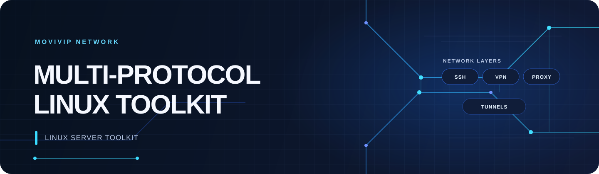
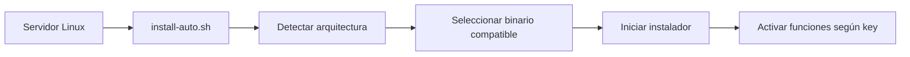

<div align="center">



# MoviVIP Network

### Una plataforma de instalación para servicios de conectividad en Linux

<p>
  <a href="https://github.com/studioanime977/MoviVIPNetwork/stargazers"></a>
  <a href="https://github.com/studioanime977/MoviVIPNetwork/network/members"></a>
  
  
</p>

<p>
  <a href="#instalacion"></a>
  <a href="https://t.me/movivip_key_bot"></a>
  <a href="https://t.me/MoviVIP"></a>
</p>

<p>
  <a href="#espanol">Español</a> ·
  <a href="#english">English</a> ·
  <a href="https://t.me/MoviVIPNetwork">Novedades</a> ·
  <a href="https://movivip-network.web.app/">Sitio oficial</a>
</p>

</div>

---

<div align="center">

**Una sola instalación. Herramientas de conectividad, túneles y administración para tu servidor Linux.**

</div>

> [!IMPORTANT]
> MoviVIP configura servicios del sistema y requiere acceso `root`. Úsalo
> únicamente en servidores que administras; conserva acceso a la consola del
> proveedor y respalda tu configuración antes de empezar.

## Español

MoviVIP Network reúne servicios de acceso, VPN, túneles, proxy y herramientas de
administración en un instalador Linux con selección automática de arquitectura.
La disponibilidad de cada función puede depender de la arquitectura, las
dependencias externas y la licencia.

<div align="center">

| 🆓 **Empieza gratis** | ✨ **Desbloquea todo** |
|:---:|:---:|
| Crea tu key gratuita desde el bot oficial de Telegram. | También puedes obtener una key Premium con todas las funciones desbloqueadas. |
| [**Crear key gratis →**](https://t.me/movivip_key_bot) | [**Ver opciones de key →**](https://t.me/movivip_key_bot) |

</div>

## Instalación

### Requisitos

- Ubuntu 20.04+ o Debian 11+.
- Acceso de `root` y conexión a Internet.
- Un servidor Linux compatible.
- Una key MoviVIP para activar las funciones correspondientes.

### Instalar desde el servidor

Conéctate al servidor como `root` y ejecuta el comando:

```bash
apt-get update -y && apt-get install -y curl
curl -fsSL -o /root/install-auto.sh https://raw.githubusercontent.com/studioanime977/MoviVIPNetwork/main/install-auto.sh
chmod +x /root/install-auto.sh
bash /root/install-auto.sh
```

El instalador detecta la arquitectura del servidor y descarga el binario
correspondiente. Para generar una key gratuita o consultar las opciones
Premium, visita [@movivip_key_bot](https://t.me/movivip_key_bot).

### Antes de empezar

- Respalda los datos y la configuración importantes.
- Asegúrate de poder entrar a la consola web o de rescate del proveedor.
- Revisa las reglas de firewall del VPS y del proveedor.
- Abre únicamente los puertos que necesiten los servicios que vas a utilizar.
- Mantén activa tu sesión SSH hasta confirmar que el acceso sigue funcionando.

## Compatibilidad

El instalador automático reconoce estas arquitecturas:

| Arquitectura Linux | Binario seleccionado |
|---|---|
| `x86_64`, `amd64` | `setup-linux-amd64` |
| `aarch64`, `arm64` | `setup-linux-arm64` |
| `armv7l`, `armhf`, `armv7`, `armv8l` | `setup-linux-armv7` |
| `armv6l` | `setup-linux-armv6` |
| `armv5l` | `setup-linux-armv5` |
| `i386`, `i686` | `setup-linux-386` |
| `loongarch64` | `setup-linux-loong64` |
| `mips` | `setup-linux-mips` |
| `mipsel` | `setup-linux-mipsle` |
| `mips64` | `setup-linux-mips64` |
| `mips64el`, `mips64le` | `setup-linux-mips64le` |
| `ppc64` | `setup-linux-ppc64` |
| `ppc64le` | `setup-linux-ppc64le` |
| `riscv64` | `setup-linux-riscv64` |
| `s390x` | `setup-linux-s390x` |

Que una arquitectura aparezca en la tabla no garantiza que todos los protocolos
o dependencias de terceros estén disponibles en ella.

## Servicios y herramientas

<details>
<summary><strong>Conectividad, VPN y túneles</strong></summary>

| Categoría | Componentes documentados |
|---|---|
| Acceso | OpenSSH, Dropbear, SSL/TLS, WebSocket |
| XRay / V2Ray | VMess, VLESS, Reality, XTLS |
| VPN | WireGuard, OpenVPN |
| Túneles | Hysteria 2, SlowDNS, VayDNS, SystemDNS, ZiVPN, DTunnel, HCR Relay, SSH-XHTTP, BHTTP v2, BTUN |
| Proxy y UDP | Shadowsocks, SOCKS5, Squid, BadVPN UDPGW, UDP Custom |

</details>

<details>
<summary><strong>Administración del servidor</strong></summary>

| Herramienta | Uso |
|---|---|
| Menú y CLI | Administración del sistema y de los servicios instalados |
| Gestor de usuarios | Gestión de cuentas y accesos |
| Bot de Telegram | Automatización y notificaciones, según licencia |
| 3X-UI | Administración de servicios XRay, según licencia |
| Panel web MoviVIP | Herramientas web del producto, según licencia |
| Webmin | Administración del servidor, según licencia |

</details>

## Flujo de instalación



## Uso responsable

- Descarga el instalador únicamente desde el
  [repositorio oficial](https://github.com/studioanime977/MoviVIPNetwork).
- No compartas tu key en capturas, canales públicos ni scripts compartidos.
- Conserva copias de seguridad y un método alternativo de acceso al servidor.
- Revisa el firewall externo del proveedor además del firewall del sistema.
- Utiliza los servicios solo en sistemas y redes que estés autorizado a administrar.

## Actualizaciones

Consulta el [canal oficial de anuncios](https://t.me/MoviVIPNetwork) para conocer
las versiones disponibles. Antes de actualizar un servidor en uso, revisa los
cambios publicados y respalda la configuración y los datos.

## Solución de problemas

| Situación | Qué revisar |
|---|---|
| `Ejecutar como root` | Ejecuta el instalador desde una sesión administrativa autorizada. |
| `Arquitectura desconocida` | Comprueba `uname -m` y confirma que tu servidor sea compatible. |
| No se puede descargar el instalador | Revisa la conexión a Internet, DNS y acceso al repositorio oficial. |
| No hay conexión al servidor después de instalar | Usa la consola del proveedor y revisa el firewall y las reglas de red. |
| Key no aceptada | Comprueba que la key esté escrita correctamente y contacta con soporte. |

## Preguntas frecuentes

<details>
<summary><strong>¿Dónde consigo una key gratuita?</strong></summary>

Puedes crearla desde el bot oficial [@movivip_key_bot](https://t.me/movivip_key_bot).
</details>

<details>
<summary><strong>¿Hay keys Premium?</strong></summary>

Sí. También puedes obtener una key Premium con todas las funciones desbloqueadas.
Consulta las opciones disponibles desde [el bot oficial](https://t.me/movivip_key_bot).
</details>

<details>
<summary><strong>¿Tengo que compilar el proyecto?</strong></summary>

No para instalar desde el repositorio público: el instalador selecciona el
binario publicado para la arquitectura reconocida.
</details>

<details>
<summary><strong>¿Todos los protocolos funcionan en todas las arquitecturas?</strong></summary>

No necesariamente. La disponibilidad puede variar según la arquitectura, las
dependencias externas y la licencia.
</details>

## Canales oficiales

| Canal | Enlace |
|---|---|
| Keys gratuitas y opciones Premium | [@movivip_key_bot](https://t.me/movivip_key_bot) |
| Licencias e instalación | [@MoviVIP](https://t.me/MoviVIP) |
| Anuncios y versiones | [@MoviVIPNetwork](https://t.me/MoviVIPNetwork) |
| Comunidad | [@MoviVIPNet](https://t.me/MoviVIPNet) |
| Sitio web | [movivip-network.web.app](https://movivip-network.web.app/) |
| Correo | [vipnetworkmovi@gmail.com](mailto:vipnetworkmovi@gmail.com) |

## Licencia

MoviVIP Network Setup y sus binarios son software propietario. El acceso y uso
están sujetos a las condiciones de la licencia correspondiente. La publicación
de un artefacto en este repositorio no concede permiso para copiarlo,
redistribuirlo, modificarlo o eludir su mecanismo de licencia.

---

<div align="center">

## English

### One Linux installer for connectivity, tunneling, and server administration

</div>

MoviVIP Network brings together access services, VPNs, tunnels, proxies, and
administration tools in a Linux installer with automatic architecture
selection. Feature availability may depend on the architecture, external
dependencies, and license.

<div align="center">

| 🆓 **Start for free** | ✨ **Unlock everything** |
|:---:|:---:|
| Create a free key with the official Telegram bot. | Premium keys are also available with all features unlocked. |
| [**Get a free key →**](https://t.me/movivip_key_bot) | [**Explore key options →**](https://t.me/movivip_key_bot) |

</div>

### Requirements

- Ubuntu 20.04+ or Debian 11+.
- Authorized `root` access and an Internet connection.
- A compatible Linux server.
- A MoviVIP key to activate the applicable features.

### Install on your server

Connect to your server as `root` and run:

```bash
apt-get update -y && apt-get install -y curl
curl -fsSL -o /root/install-auto.sh https://raw.githubusercontent.com/studioanime977/MoviVIPNetwork/main/install-auto.sh
chmod +x /root/install-auto.sh
bash /root/install-auto.sh
```

The installer detects the server architecture and downloads the corresponding
binary. Get a free key or learn about Premium keys at
[@movivip_key_bot](https://t.me/movivip_key_bot).

### Supported architectures

| Linux architecture | Selected binary |
|---|---|
| `x86_64`, `amd64` | `setup-linux-amd64` |
| `aarch64`, `arm64` | `setup-linux-arm64` |
| `armv7l`, `armhf`, `armv7`, `armv8l` | `setup-linux-armv7` |
| `armv6l` | `setup-linux-armv6` |
| `armv5l` | `setup-linux-armv5` |
| `i386`, `i686` | `setup-linux-386` |
| `loongarch64` | `setup-linux-loong64` |
| `mips`, `mipsel`, `mips64`, `mips64el` | Matching MIPS binary |
| `ppc64`, `ppc64le` | Matching PowerPC binary |
| `riscv64` | `setup-linux-riscv64` |
| `s390x` | `setup-linux-s390x` |

Architecture recognition does not guarantee every protocol or third-party
dependency is available on that system.

### Included services

The documented service set includes OpenSSH, Dropbear, SSL/TLS, WebSocket,
XRay/V2Ray (VMess, VLESS, Reality, XTLS), WireGuard, OpenVPN, Hysteria 2,
SlowDNS, VayDNS, SystemDNS, ZiVPN, DTunnel, HCR Relay, SSH-XHTTP, BHTTP v2,
BTUN, Shadowsocks, SOCKS5, Squid, BadVPN UDPGW, and UDP Custom. Administration
tools include the CLI, user manager, Telegram bot, 3X-UI, MoviVIP web panel,
and Webmin. Availability depends on license and architecture.

### Responsible use

- Download the installer only from the
  [official repository](https://github.com/studioanime977/MoviVIPNetwork).
- Do not share your key in screenshots, public channels, or shared scripts.
- Keep backups and an alternative way to access your server.
- Check both provider-level and system firewalls.
- Use these services only on systems and networks you are authorized to manage.

### Updates and troubleshooting

See the [official announcements channel](https://t.me/MoviVIPNetwork) for
available versions. Back up configuration and data before updating a server
in use.

| Situation | What to check |
|---|---|
| Root access required | Run the installer from an authorized administrative session. |
| Unknown architecture | Check `uname -m` and confirm your server is supported. |
| Installer download fails | Check Internet access, DNS, and connectivity to the official repository. |
| Server access changed | Use the provider console and inspect firewall and network rules. |
| Key rejected | Check the key and contact support to review activation. |

### Official channels

- Free keys and Premium options: [@movivip_key_bot](https://t.me/movivip_key_bot)
- Licensing and installation support: [@MoviVIP](https://t.me/MoviVIP)
- Release announcements: [@MoviVIPNetwork](https://t.me/MoviVIPNetwork)
- Community: [@MoviVIPNet](https://t.me/MoviVIPNet)
- [Website](https://movivip-network.web.app/)
- [Email](mailto:vipnetworkmovi@gmail.com)

### License

MoviVIP Network Setup and its binaries are proprietary software. Access and use
are subject to the applicable license terms. Publishing an artifact here does
not grant permission to copy, redistribute, modify, or bypass its license
mechanism.

---

<div align="center">

**MoviVIP Network** · Linux servers · Connectivity · Administration

<a href="https://github.com/studioanime977/MoviVIPNetwork">GitHub</a> ·
<a href="https://t.me/movivip_key_bot">Get a key</a> ·
<a href="https://t.me/MoviVIP">Support</a> ·
<a href="https://t.me/MoviVIPNetwork">Announcements</a>

</div>
